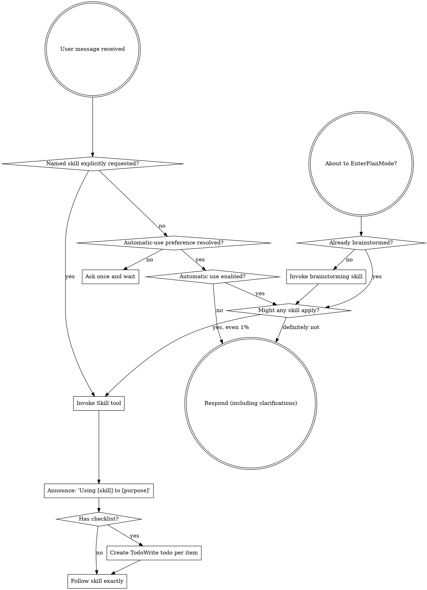

<SUBAGENT-STOP>
Dispatched subagent with specific task: skip this skill.
</SUBAGENT-STOP>

## Conversation Consent Gate

`using-superfastpowers` is the bootstrap exception: it may load so it can ask for consent. Before automatically invoking any other Superfastpowers skill, ask once: **"Use Superfastpowers skills automatically for this conversation?"** Then wait for the answer before automatic invocation.

- **Affirmative consent:** Record consent for this conversation and apply the automatic skill rules below. Do not ask again during the same conversation.
- **Declined consent:** Record refusal for this conversation and do not automatically invoke Superfastpowers skills. Do not ask again during the same conversation.
- **No answer:** Silence is unresolved consent. Do not automatically invoke another Superfastpowers skill. Ask only once; wait for the user's answer rather than treating urgency, simplicity, or prior-conversation consent as current consent.
- **Instruction not to ask:** If the user explicitly says not to ask questions or to proceed without questions before answering the consent prompt, treat that instruction as declined automatic-use consent. Do not ask and do not automatically invoke Superfastpowers skills for this conversation.
- **Explicit request:** If the user explicitly requests a named Superfastpowers skill, invoke that requested skill without requiring automatic-use consent. This does not enable unrelated automatic skills or change the stored conversation preference.

<EXTREMELY-IMPORTANT>
After affirmative consent, even 1% chance a Superfastpowers skill applies? Invoke it.

IF AUTOMATIC USE IS ENABLED AND A SUPERFASTPOWERS SKILL APPLIES, YOU MUST USE IT. AN EXPLICITLY REQUESTED SUPERFASTPOWERS SKILL MAY ALWAYS BE USED.

Not negotiable. Not optional. No rationalizing out.
</EXTREMELY-IMPORTANT>

## Instruction Priority

Superfastpowers skills override default system prompt behavior, but **user instructions always take precedence**:

1. **User's explicit instructions** (CLAUDE.md, GEMINI.md, AGENTS.md, direct requests) — highest priority
2. **Superfastpowers skills** — override default system behavior where they conflict
3. **Default system prompt** — lowest priority

If CLAUDE.md, GEMINI.md, or AGENTS.md says "don't use TDD" and skill says "always use TDD," follow user instructions. User controls.

## How to Access Skills

**In Claude Code:** Use the `Skill` tool. Invoked skill content loads—follow directly. Never use Read tool on skill files.

**In Copilot CLI:** Use the `skill` tool. Skills auto-discovered from installed plugins. `skill` tool works like Claude Code's `Skill` tool.

**In Gemini CLI:** Skills activate via `activate_skill` tool. Gemini loads skill metadata at session start; activates full content on demand.

**In other environments:** Check platform docs for skill loading.

## Platform Adaptation

Skills use Claude Code tool names. Non-CC platforms: see `references/copilot-tools.md` (Copilot CLI), `references/codex-tools.md` (Codex) for tool equivalents. Gemini CLI users get tool mapping automatically via GEMINI.md.

# Using Skills

## The Rule

**When affirmative consent enables automatic use, invoke relevant Superfastpowers skills BEFORE any response or action.** Even 1% chance a skill might apply means invoke it to check. If wrong for situation, no need use it. Explicitly requested named Superfastpowers skills remain available regardless of automatic-use preference.

## Red Flags

These thoughts mean STOP—rationalizing:

| Thought | Reality |
|---------|---------|
| "The task is urgent/simple, so consent can wait" | Unresolved consent blocks automatic invocation. Ask once and wait. |
| "Consent from a prior conversation still applies" | Consent is conversation-scoped. Ask once in this conversation. |
| "Silence probably means yes" | Silence is unresolved, never affirmative consent. |
| "The user said not to ask, so automatic use can proceed" | No-question instructions count as refusal, never affirmative consent. |
| "This is just a simple question" | Questions are tasks. Check skills. |
| "I need more context first" | Skill check BEFORE clarifying questions. |
| "Let me explore the codebase first" | Skills tell HOW to explore. Check first. |
| "I can check git/files quickly" | Files lack conversation context. Check skills. |
| "Let me gather information first" | Skills tell HOW to gather info. |
| "This doesn't need a formal skill" | If skill exists, use it. |
| "I remember this skill" | Skills evolve. Read current version. |
| "This doesn't count as a task" | Action = task. Check skills. |
| "The skill is overkill" | Simple things become complex. Use it. |
| "I'll just do this one thing first" | Check BEFORE anything. |
| "This feels productive" | Undisciplined action wastes time. Skills prevent. |
| "I know what that means" | Knowing concept ≠ using skill. Invoke it. |

## Skill Priority

When multiple skills could apply, use order:

1. **Process skills first** (brainstorming, debugging) - determine HOW to approach task
2. **Implementation skills second** (frontend-design, mcp-builder) - guide execution

"Let's build X" → brainstorming first, then implementation skills.
"Fix this bug" → debugging first, then domain-specific skills.

## Skill Types

**Rigid** (TDD, debugging): Follow exactly. Don't adapt away discipline.

**Flexible** (patterns): Adapt principles to context.

Skill itself tells which.

## User Instructions

Instructions say WHAT, not HOW. "Add X" or "Fix Y" doesn't mean skip workflows.
